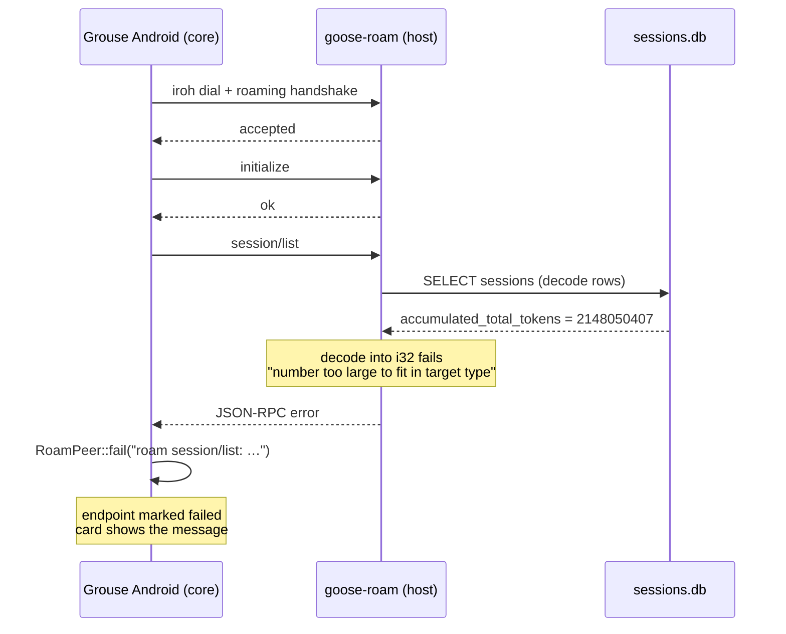

# Roam endpoint could not connect: a 32-bit session counter broke `session/list`

**Date:** 2026-11-09
**Scope:** goose host (`goose-roam.service`), Grouse Android roam client
**Status:** host repaired; client diagnostics shipped in 0.2.93–0.2.95
**Durable fix:** still open — goose decodes the `accumulated_*_tokens` columns
into a 32-bit type (see [Follow-ups](#follow-ups))

## Summary

The Android roam endpoint stopped connecting. The client showed no reason at
first, then a brief `error`, and finally the server's real message:

```
error occurred while decoding column "accumulated_total_tokens":
number too large to fit in target type
```

The host's session database holds one row whose lifetime token counter passed
`i32::MAX`:

| session | name | `accumulated_total_tokens` | `i32::MAX` | over by |
|---|---|---|---|---|
| `20261029_4` | Grouse | 2,148,050,407 | 2,147,483,647 | 566,760 |

goose reads that column into a 32-bit integer. The row cannot be decoded, so
**every** session query fails — including the `session/list` request that is
the first real step of the roam handshake. The endpoint therefore never bound a
session, and nothing about the failure looked like a transport problem: iroh
dialed, the relay answered, the host accepted the device, and the handshake
died on a database row.

Roam and the main WebSocket connection use different session databases. The
container's database had no overflowing row, which is why only Roam broke.

## Timeline (local time, MST)

| time | event |
|---|---|
| 2026-11-08 20:34:53 | `goose-roam.service` stopped and restarted (explicit `systemctl --user restart`). Same endpoint id `87ead420…`, same 3 accepted peers. |
| 20:34:53+ | The phone re-dialed. `session/list` failed on the bad row; the client retried, gave up, and showed a bare `error`. |
| 2026-11-09 ~03:30 | Client fixes 0.2.93–0.2.95: dial bounded at 30 s, terminal errors no longer auto-redialed, status text never collapses to `error`. |
| ~04:15 | The card printed the server's decode error, which identified the failing column. |
| ~04:25 | Host repair: counters reset, service restarted, `goose session list` verified. |

The restart is what made it visible: before it, the phone held an established
connection and never needed a fresh `session/list`. Any later drop or app
restart would have exposed the same failure.

## Failure path



The relevant client paths are `grouse-core/src/roam.rs` (`attempt` →
`handshake_and_serve` → `list_all_peer_sessions`, with `self.fail(...)` on
error) and the Android status mapping in `ConnectionManager.kt`.

## Evidence

Before the repair, the same decode failure was reproducible without the phone:

```sh
$ goose session list
Error: error occurred while decoding column "accumulated_total_tokens":
number too large to fit in target type

Caused by:
    number too large to fit in target type
```

The database confirmed the arithmetic:

```sh
python3 - <<'EOF'
import sqlite3
db = sqlite3.connect('/home/colin/.local/share/goose/sessions/sessions.db')
c = db.cursor()
c.execute("SELECT id, accumulated_total_tokens FROM sessions "
          "WHERE accumulated_total_tokens > 2147483647")
print(c.fetchall())
EOF
# [('20261029_4', 2148050407)]
```

A fresh session against the same provider, key, and gateway answered
immediately, which ruled out the model provider:

```sh
$ set -a; source ~/.config/goose/roam.env; set +a
$ goose run -t "Reply with exactly: ok"
ok
```

## Repair (applied)

```sh
systemctl --user stop goose-roam.service
cp -a ~/.local/share/goose/sessions/sessions.db \
      ~/.local/share/goose/sessions/sessions.db.bak-pre-token-overflow-20261109
```

```sql
UPDATE sessions SET
  accumulated_total_tokens       = 0,
  accumulated_input_tokens       = 0,
  accumulated_output_tokens      = 0,
  accumulated_cache_read_tokens  = 0,
  accumulated_cache_write_tokens = 0
WHERE id = '20261029_4';
```

```sh
systemctl --user start goose-roam.service
goose session list     # decodes every session
```

Only the lifetime accounting counters were reset; the conversation, the
session id, and `accumulated_cost` are untouched. `accumulated_cache_read_tokens`
(2,010,468,864) and `accumulated_input_tokens` (2,144,831,956) were just under
the limit and were reset in the same pass to avoid a second overflow.

On the device, tap **Retry** on the endpoint card: since 0.2.94 a failed peer is
not re-dialed behind the user's back.

## Client fixes that made this diagnosable

| version | commit | change |
|---|---|---|
| 0.2.93 | `b4e9fb2c` | The iroh dial is bounded at 30 s, so a stalled attempt becomes a retry and a terminal status instead of hanging the supervisor forever. Endpoint card names the phase. |
| 0.2.94 | `018a8bd4` | A terminal error is no longer overwritten by an automatic re-dial one second later. The error stays on the card with a **Retry**; opening the Roam screen no longer re-dials failed peers. |
| 0.2.95 | `df63105f` | No surface shows a bare `error`: the short status carries the transport's reason, the chip shows the first 30 characters, and the card shows the full explanation. JVM test updated to require the reason. |

## Follow-ups

1. **Widen the columns in goose (durable fix).** The session row struct decodes
   `accumulated_*_tokens` as 32-bit. They are lifetime sums and must be 64-bit.
   The host runs a patched 1.56 binary (`/mnt/data/build/goose-1560-patched`);
   its source tree must be located (the service unit references
   `/mnt/data/build/goose-main`) before a patch and rebuild can replace the
   band-aid. Until then, the counter will cross `i32::MAX` again after roughly
   another 2.1B accumulated tokens, and the same failure returns.
2. **Treat a decode failure as a server fault, not a peer fault.** The client
   cannot distinguish `session/list` returning a JSON-RPC error from a network
   failure today; both end as `RoamPeer::fail`. A server-provided error is worth
   keeping distinct in the card text (it is now visible, which is the main win).
3. **Health check.** `goose session list` exercises the same row decoding the
   ACP list does. Running it after a goose upgrade or a service restart catches
   this class of failure before a client does.
4. **Consider a client-side guard.** None is possible for the decode itself —
   the server fails the whole list — but the client could surface "the host's
   session store is unreadable" for errors that name a column, instead of the
   raw sqlx text.

## Lessons

- A protocol handshake that depends on a list can be broken by a single row.
- A bounded transport timeout and a status that names its reason turn an
  opaque "cannot connect" into a one-line root cause. The UI work was not
  cosmetic; it is what produced the evidence.
- The model-provider error text we first chased was a red herring: the same
  string space ("accumulated … tokens") belongs to the session store, and a
  fresh session proved the provider healthy.
